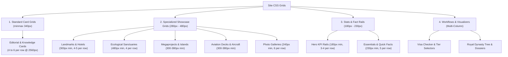

# Site-Wide Grid Architecture & Layout Inventory Report

> **Sovereign Nation of Waikiki** · Design System & CSS Grid Matrix Audit  
> **Scope**: 100 HTML pages (46 English, 46 Hungarian, 8 Root/Redirects), 32 pages utilizing CSS Grids, 193 grid containers, and 1038 total items analyzed at ultra-wide 2560px resolution.

---

## 1. Executive Summary & Grid Archetype Matrix

Across the Sovereign Nation of Waikiki portal, CSS Grid is the fundamental layout primitive for card collections, architectural showcases, data telemetry, and interactive controls. All layouts adhere to a desktop-first responsive paradigm configured for edge-to-edge high-density displays (up to 2560px ultra-wide) down to 430px mobile viewports.

### High-Level Statistics

| Metric | Count / Value | Description |
| :--- | :--- | :--- |
| **Pages Utilizing Grids** | **32 pages** | Active English and Hungarian counterpart pages |
| **Total Grid Containers** | **193 containers** | Primary section grids, stat rails, and showcase galleries |
| **Total Rendered Items** | **1038 items** | Cards, metrics, dossiers, hotels, landmarks, and zones |
| **Grids with Icons** | **73 (38%)** | Grids featuring Material Design Icons or `.card-icon` markers |
| **Grids with Raster Images** | **22 (11%)** | Grids displaying high-resolution photography (`.jpg`, `.webp`) |
| **Grids with Vector SVGs** | **73 (38%)** | Grids with inline generated SVG art or standalone SVG illustrations |
| **Standard Card Min-Width** | `340px` (`min(100%, 340px)`) | Default `.card-grid` sizing in `css/common.css` |
| **Max Items Per Row (2560px)** | **6 items** | Standard `.card-grid` with full container width or `.gallery-grid` |
| **Min Items Per Row (2560px)** | **2 items** | Dual-pane comparisons, financial charts, and split aircraft cards |

---

## 2. Design System Grid Archetypes

The portal organizes grid layouts into 5 standardized design-system archetypes:

1. **Standard Knowledge Card Grid (`.card-grid`)**:
   - **CSS Definition**: `display: grid; grid-template-columns: repeat(auto-fit, minmax(min(100%, 340px), 1fr)); gap: var(--card-gap);`
   - **Behavior at 2560px**: Expands up to `var(--width-full)` (1920px - 2400px), cleanly rendering **4, 5, or 6 cards per row** depending on container constraints.
   - **Media Profile**: 90% feature vector SVG iconography (`.card-icon`) with gold-tinted subtle backgrounds.

2. **Showcase & Architectural Grids (`.landmark-grid`, `.hotel-grid`)**:
   - **CSS Definition**: `grid-template-columns: repeat(auto-fill, minmax(min(100%, 300px), 1fr)); max-width: 1600px;`
   - **Behavior at 2560px**: Capped at `1600px` for optimal readability and aesthetic proportion, generating exactly **4 or 5 cards per row**.
   - **Media Profile**: Feature inline generated vector illustrations (`.hotel-art`, `.building-art`, `.landmark-top`) or photographic badges.

3. **Wide Panoramic Card Grids (`.sanctuaries-grid`, `.card-grid` in Travel & Infrastructure)**:
   - **CSS Definition**: `minmax(min(100%, 480px), 1fr)`
   - **Behavior at 2560px**: Spans **3 or 4 wide-format cards per row** to accommodate rich geographic, ecological, and mobility telemetry.

4. **Photo Stream Gallery (`.gallery-grid`)**:
   - **CSS Definition**: `repeat(auto-fill, minmax(240px, 1fr))` (Medium), `minmax(180px, 1fr)` (Mini), `minmax(360px, 1fr)` (Large)
   - **Behavior at 2560px**: Renders **6 columns** (Medium view), **8-10 columns** (Mini view), or **4 columns** (Large view) with masonry-like aspect-ratio photo tiles.

5. **Header KPI & Metric Rails (`.hero-stats`, `.fact-grid`)**:
   - **CSS Definition**: `repeat(auto-fit, minmax(180px, 1fr))` (`.hero-stats`), `repeat(auto-fit, minmax(min(100%, 230px), 1fr))` (`.fact-grid`)
   - **Behavior at 2560px**: Compact single-row or double-row telemetry bar rendering **3, 4, or 5 KPI chips** across the header banner.

---

## 3. Comprehensive Page-by-Page Grid Inventory

The table below details every grid container audited in the site, measured directly at **2560px ultra-wide resolution**:

| Page | Section / Grid Selector | Context / Description | CSS Min Width | Items / Row (2560px) | Total Items | Has Icon | Has Image | Has SVG |
| :--- | :--- | :--- | :---: | :---: | :---: | :---: | :---: | :---: |
| [angelina-and-taylor-gallery.html](file:///Volumes/Samsung%20X5%20SSD/Projektek/Site/en/angelina-and-taylor-gallery.html) / [hu](file:///Volumes/Samsung%20X5%20SSD/Projektek/Site/hu/angelina-and-taylor-gallery.html) | `div#gallery-grid.gallery-grid` | Dynamic High-Resolution Photography Stream | `240px` | **6** | **48** | No | Yes | No |
| [angelina-and-taylor-private.html](file:///Volumes/Samsung%20X5%20SSD/Projektek/Site/en/angelina-and-taylor-private.html) / [hu](file:///Volumes/Samsung%20X5%20SSD/Projektek/Site/hu/angelina-and-taylor-private.html) | `div.content-grid` | An Exemplary Partnership Cards | `auto` | **1** | **3** | No | No | No |
| [angelina-and-taylor-private.html](file:///Volumes/Samsung%20X5%20SSD/Projektek/Site/en/angelina-and-taylor-private.html) / [hu](file:///Volumes/Samsung%20X5%20SSD/Projektek/Site/hu/angelina-and-taylor-private.html) | `div.image-gallery` | An Exemplary Partnership Cards | `auto` | **1** | **1** | No | Yes | No |
| [angelina-and-taylor-private.html](file:///Volumes/Samsung%20X5%20SSD/Projektek/Site/en/angelina-and-taylor-private.html) / [hu](file:///Volumes/Samsung%20X5%20SSD/Projektek/Site/hu/angelina-and-taylor-private.html) | `div.content-grid` | The Deeper Dimensions of the Relationship Cards | `auto` | **1** | **3** | No | No | No |
| [angelina-and-taylor-private.html](file:///Volumes/Samsung%20X5%20SSD/Projektek/Site/en/angelina-and-taylor-private.html) / [hu](file:///Volumes/Samsung%20X5%20SSD/Projektek/Site/hu/angelina-and-taylor-private.html) | `div.image-gallery` | The Deeper Dimensions of the Relationship Cards | `auto` | **1** | **1** | No | Yes | No |
| [angelina-and-taylor-private.html](file:///Volumes/Samsung%20X5%20SSD/Projektek/Site/en/angelina-and-taylor-private.html) / [hu](file:///Volumes/Samsung%20X5%20SSD/Projektek/Site/hu/angelina-and-taylor-private.html) | `div.content-grid` | Shared Adventures and Travels Cards | `auto` | **1** | **3** | No | No | No |
| [angelina-and-taylor-private.html](file:///Volumes/Samsung%20X5%20SSD/Projektek/Site/en/angelina-and-taylor-private.html) / [hu](file:///Volumes/Samsung%20X5%20SSD/Projektek/Site/hu/angelina-and-taylor-private.html) | `div.image-gallery` | Shared Adventures and Travels Cards | `auto` | **1** | **1** | No | Yes | No |
| [angelina-and-taylor-private.html](file:///Volumes/Samsung%20X5%20SSD/Projektek/Site/en/angelina-and-taylor-private.html) / [hu](file:///Volumes/Samsung%20X5%20SSD/Projektek/Site/hu/angelina-and-taylor-private.html) | `div.content-grid` | Relationship Milestones Cards | `auto` | **1** | **3** | No | No | No |
| [angelina-and-taylor-private.html](file:///Volumes/Samsung%20X5%20SSD/Projektek/Site/en/angelina-and-taylor-private.html) / [hu](file:///Volumes/Samsung%20X5%20SSD/Projektek/Site/hu/angelina-and-taylor-private.html) | `div.image-gallery` | Relationship Milestones Cards | `auto` | **1** | **1** | No | Yes | No |
| [banking-system.html](file:///Volumes/Samsung%20X5%20SSD/Projektek/Site/en/banking-system.html) / [hu](file:///Volumes/Samsung%20X5%20SSD/Projektek/Site/hu/banking-system.html) | `div.hero-stats` | Hero Telemetry & Key Metrics Rail | `180px` | **4** | **4** | No | No | No |
| [banking-system.html](file:///Volumes/Samsung%20X5%20SSD/Projektek/Site/en/banking-system.html) / [hu](file:///Volumes/Samsung%20X5%20SSD/Projektek/Site/hu/banking-system.html) | `div.card-grid.bank-grid` | Banking Pillars & Monetary Infrastructure (pillars) | `460px` | **3** | **3** | Yes | No | Yes |
| [banking-system.html](file:///Volumes/Samsung%20X5%20SSD/Projektek/Site/en/banking-system.html) / [hu](file:///Volumes/Samsung%20X5%20SSD/Projektek/Site/hu/banking-system.html) | `div.card-grid` | National Currency and Monetary Policy Cards | `340px` | **4** | **4** | Yes | No | Yes |
| [banking-system.html](file:///Volumes/Samsung%20X5%20SSD/Projektek/Site/en/banking-system.html) / [hu](file:///Volumes/Samsung%20X5%20SSD/Projektek/Site/hu/banking-system.html) | `div.card-grid.bank-grid` | Banking Pillars & Monetary Infrastructure (rates-stability) | `460px` | **4** | **4** | Yes | No | Yes |
| [banking-system.html](file:///Volumes/Samsung%20X5%20SSD/Projektek/Site/en/banking-system.html) / [hu](file:///Volumes/Samsung%20X5%20SSD/Projektek/Site/hu/banking-system.html) | `div.card-grid` | The Waikiki Stock Exchange and Capital Markets Cards | `340px` | **4** | **4** | Yes | No | Yes |
| [chease-and-jessica-gallery.html](file:///Volumes/Samsung%20X5%20SSD/Projektek/Site/en/chease-and-jessica-gallery.html) / [hu](file:///Volumes/Samsung%20X5%20SSD/Projektek/Site/hu/chease-and-jessica-gallery.html) | `div#gallery-grid.gallery-grid` | Dynamic High-Resolution Photography Stream | `240px` | **6** | **48** | No | Yes | No |
| [chease-and-jessica-private.html](file:///Volumes/Samsung%20X5%20SSD/Projektek/Site/en/chease-and-jessica-private.html) / [hu](file:///Volumes/Samsung%20X5%20SSD/Projektek/Site/hu/chease-and-jessica-private.html) | `div.content-grid` | An Exemplary Partnership Cards | `auto` | **1** | **3** | No | No | No |
| [chease-and-jessica-private.html](file:///Volumes/Samsung%20X5%20SSD/Projektek/Site/en/chease-and-jessica-private.html) / [hu](file:///Volumes/Samsung%20X5%20SSD/Projektek/Site/hu/chease-and-jessica-private.html) | `div.image-gallery` | An Exemplary Partnership Cards | `auto` | **1** | **1** | No | Yes | No |
| [chease-and-jessica-private.html](file:///Volumes/Samsung%20X5%20SSD/Projektek/Site/en/chease-and-jessica-private.html) / [hu](file:///Volumes/Samsung%20X5%20SSD/Projektek/Site/hu/chease-and-jessica-private.html) | `div.content-grid` | The Deeper Dimensions of Their Bond Cards | `auto` | **1** | **3** | No | No | No |
| [chease-and-jessica-private.html](file:///Volumes/Samsung%20X5%20SSD/Projektek/Site/en/chease-and-jessica-private.html) / [hu](file:///Volumes/Samsung%20X5%20SSD/Projektek/Site/hu/chease-and-jessica-private.html) | `div.image-gallery` | The Deeper Dimensions of Their Bond Cards | `auto` | **1** | **1** | No | Yes | No |
| [chease-and-jessica-private.html](file:///Volumes/Samsung%20X5%20SSD/Projektek/Site/en/chease-and-jessica-private.html) / [hu](file:///Volumes/Samsung%20X5%20SSD/Projektek/Site/hu/chease-and-jessica-private.html) | `div.content-grid` | Shared Journeys and Defining Moments Cards | `auto` | **1** | **3** | No | No | No |
| [chease-and-jessica-private.html](file:///Volumes/Samsung%20X5%20SSD/Projektek/Site/en/chease-and-jessica-private.html) / [hu](file:///Volumes/Samsung%20X5%20SSD/Projektek/Site/hu/chease-and-jessica-private.html) | `div.image-gallery` | Shared Journeys and Defining Moments Cards | `auto` | **1** | **1** | No | Yes | No |
| [chease-and-jessica-private.html](file:///Volumes/Samsung%20X5%20SSD/Projektek/Site/en/chease-and-jessica-private.html) / [hu](file:///Volumes/Samsung%20X5%20SSD/Projektek/Site/hu/chease-and-jessica-private.html) | `div.content-grid` | A Legacy of Partnership Cards | `auto` | **1** | **3** | No | No | No |
| [chease-and-jessica-private.html](file:///Volumes/Samsung%20X5%20SSD/Projektek/Site/en/chease-and-jessica-private.html) / [hu](file:///Volumes/Samsung%20X5%20SSD/Projektek/Site/hu/chease-and-jessica-private.html) | `div.image-gallery` | A Legacy of Partnership Cards | `auto` | **1** | **1** | No | Yes | No |
| [citizenship.html](file:///Volumes/Samsung%20X5%20SSD/Projektek/Site/en/citizenship.html) / [hu](file:///Volumes/Samsung%20X5%20SSD/Projektek/Site/hu/citizenship.html) | `div.card-grid` | Initial Screening Tiers Cards | `340px` | **6** | **6** | Yes | No | Yes |
| [citizenship.html](file:///Volumes/Samsung%20X5%20SSD/Projektek/Site/en/citizenship.html) / [hu](file:///Volumes/Samsung%20X5%20SSD/Projektek/Site/hu/citizenship.html) | `div.card-grid.process-grid` | Immigration & Naturalization Process Steps | `320px` | **3** | **3** | Yes | No | Yes |
| [culture.html](file:///Volumes/Samsung%20X5%20SSD/Projektek/Site/en/culture.html) / [hu](file:///Volumes/Samsung%20X5%20SSD/Projektek/Site/hu/culture.html) | `div.hero-stats` | Hero Telemetry & Key Metrics Rail | `180px` | **4** | **4** | No | No | No |
| [culture.html](file:///Volumes/Samsung%20X5%20SSD/Projektek/Site/en/culture.html) / [hu](file:///Volumes/Samsung%20X5%20SSD/Projektek/Site/hu/culture.html) | `div.card-grid` | Arts and Culture Cards | `340px` | **4** | **4** | Yes | No | Yes |
| [culture.html](file:///Volumes/Samsung%20X5%20SSD/Projektek/Site/en/culture.html) / [hu](file:///Volumes/Samsung%20X5%20SSD/Projektek/Site/hu/culture.html) | `div.card-grid` | Technology and Innovation Cards | `340px` | **3** | **3** | Yes | No | Yes |
| [culture.html](file:///Volumes/Samsung%20X5%20SSD/Projektek/Site/en/culture.html) / [hu](file:///Volumes/Samsung%20X5%20SSD/Projektek/Site/hu/culture.html) | `div.card-grid` | Space Exploration Cards | `340px` | **4** | **4** | Yes | No | Yes |
| [culture.html](file:///Volumes/Samsung%20X5%20SSD/Projektek/Site/en/culture.html) / [hu](file:///Volumes/Samsung%20X5%20SSD/Projektek/Site/hu/culture.html) | `div.card-grid` | Daily Life and Sports Cards | `340px` | **5** | **5** | Yes | No | Yes |
| [diplomacy.html](file:///Volumes/Samsung%20X5%20SSD/Projektek/Site/en/diplomacy.html) / [hu](file:///Volumes/Samsung%20X5%20SSD/Projektek/Site/hu/diplomacy.html) | `div.hero-stats` | Hero Telemetry & Key Metrics Rail | `180px` | **4** | **4** | No | No | No |
| [diplomacy.html](file:///Volumes/Samsung%20X5%20SSD/Projektek/Site/en/diplomacy.html) / [hu](file:///Volumes/Samsung%20X5%20SSD/Projektek/Site/hu/diplomacy.html) | `div.card-grid` | Security and Defense Alliances Cards | `340px` | **4** | **4** | Yes | No | Yes |
| [diplomacy.html](file:///Volumes/Samsung%20X5%20SSD/Projektek/Site/en/diplomacy.html) / [hu](file:///Volumes/Samsung%20X5%20SSD/Projektek/Site/hu/diplomacy.html) | `div.card-grid` | Economic and Trade Partnerships Cards | `340px` | **4** | **4** | Yes | No | Yes |
| [diplomacy.html](file:///Volumes/Samsung%20X5%20SSD/Projektek/Site/en/diplomacy.html) / [hu](file:///Volumes/Samsung%20X5%20SSD/Projektek/Site/hu/diplomacy.html) | `div.card-grid` | Global Governance Initiatives Cards | `340px` | **4** | **4** | Yes | No | Yes |
| [diplomacy.html](file:///Volumes/Samsung%20X5%20SSD/Projektek/Site/en/diplomacy.html) / [hu](file:///Volumes/Samsung%20X5%20SSD/Projektek/Site/hu/diplomacy.html) | `div.card-grid` | Regional Unions and Cooperation Cards | `340px` | **5** | **5** | Yes | No | Yes |
| [economy.html](file:///Volumes/Samsung%20X5%20SSD/Projektek/Site/en/economy.html) / [hu](file:///Volumes/Samsung%20X5%20SSD/Projektek/Site/hu/economy.html) | `div.hero-stats` | Hero Telemetry & Key Metrics Rail | `180px` | **4** | **4** | No | No | No |
| [economy.html](file:///Volumes/Samsung%20X5%20SSD/Projektek/Site/en/economy.html) / [hu](file:///Volumes/Samsung%20X5%20SSD/Projektek/Site/hu/economy.html) | `div.chart-grid` | Economic Data Visualization Cards (employment) | `460px` | **2** | **2** | No | No | No |
| [economy.html](file:///Volumes/Samsung%20X5%20SSD/Projektek/Site/en/economy.html) / [hu](file:///Volumes/Samsung%20X5%20SSD/Projektek/Site/hu/economy.html) | `div.chart-grid` | Economic Data Visualization Cards (trade) | `460px` | **2** | **2** | No | No | No |
| [economy.html](file:///Volumes/Samsung%20X5%20SSD/Projektek/Site/en/economy.html) / [hu](file:///Volumes/Samsung%20X5%20SSD/Projektek/Site/hu/economy.html) | `div.chart-grid` | Economic Data Visualization Cards (inequality-savings) | `460px` | **2** | **2** | No | No | No |
| [family-tree.html](file:///Volumes/Samsung%20X5%20SSD/Projektek/Site/en/family-tree.html) / [hu](file:///Volumes/Samsung%20X5%20SSD/Projektek/Site/hu/family-tree.html) | `div.overview-pillars-grid` | Constitutional Monarchy Pillars | `repeat(3, 1fr)` | **3** | **3** | No | No | No |
| [family-tree.html](file:///Volumes/Samsung%20X5%20SSD/Projektek/Site/en/family-tree.html) / [hu](file:///Volumes/Samsung%20X5%20SSD/Projektek/Site/hu/family-tree.html) | `div.tree-branches-row` | Dynastic Branch Overview Cards | `repeat(3, 1fr)` | **3** | **3** | No | Yes | No |
| [family-tree.html](file:///Volumes/Samsung%20X5%20SSD/Projektek/Site/en/family-tree.html) / [hu](file:///Volumes/Samsung%20X5%20SSD/Projektek/Site/hu/family-tree.html) | `div.dossiers-grid` | Royal Family Member Dossiers & Profiles | `0px` | **2** | **8** | No | Yes | No |
| [family-tree.html](file:///Volumes/Samsung%20X5%20SSD/Projektek/Site/en/family-tree.html) / [hu](file:///Volumes/Samsung%20X5%20SSD/Projektek/Site/hu/family-tree.html) | `div.succession-grid` | Constitutional Order of Succession Cards | `repeat(4, 1fr)` | **4** | **8** | No | No | No |
| [family-tree.html](file:///Volumes/Samsung%20X5%20SSD/Projektek/Site/en/family-tree.html) / [hu](file:///Volumes/Samsung%20X5%20SSD/Projektek/Site/hu/family-tree.html) | `div.governance-matrix-grid` | Strategic Governance Matrix Cards | `repeat(3, 1fr)` | **3** | **6** | Yes | No | Yes |
| [government.html](file:///Volumes/Samsung%20X5%20SSD/Projektek/Site/en/government.html) / [hu](file:///Volumes/Samsung%20X5%20SSD/Projektek/Site/hu/government.html) | `div.card-grid` | Presidents of Waikiki Cards | `380px` | **5** | **5** | No | Yes | No |
| [government.html](file:///Volumes/Samsung%20X5%20SSD/Projektek/Site/en/government.html) / [hu](file:///Volumes/Samsung%20X5%20SSD/Projektek/Site/hu/government.html) | `div.card-grid` | The Current Government Cards | `380px` | **6** | **20** | No | Yes | No |
| [government.html](file:///Volumes/Samsung%20X5%20SSD/Projektek/Site/en/government.html) / [hu](file:///Volumes/Samsung%20X5%20SSD/Projektek/Site/hu/government.html) | `div.card-grid` | Dictatorial Cabinet Cards | `380px` | **6** | **18** | Yes | Yes | No |
| [history.html](file:///Volumes/Samsung%20X5%20SSD/Projektek/Site/en/history.html) / [hu](file:///Volumes/Samsung%20X5%20SSD/Projektek/Site/hu/history.html) | `div.hero-stats` | Hero Telemetry & Key Metrics Rail | `180px` | **4** | **4** | No | No | No |
| [history.html](file:///Volumes/Samsung%20X5%20SSD/Projektek/Site/en/history.html) / [hu](file:///Volumes/Samsung%20X5%20SSD/Projektek/Site/hu/history.html) | `div.card-grid` | Historical Eras Cards | `340px` | **4** | **4** | No | No | No |
| [ideology.html](file:///Volumes/Samsung%20X5%20SSD/Projektek/Site/en/ideology.html) / [hu](file:///Volumes/Samsung%20X5%20SSD/Projektek/Site/hu/ideology.html) | `div.grid-container` | Four Pillars Cards | `320px` | **4** | **4** | Yes | No | Yes |
| [index.html](file:///Volumes/Samsung%20X5%20SSD/Projektek/Site/en/index.html) / [hu](file:///Volumes/Samsung%20X5%20SSD/Projektek/Site/hu/index.html) | `div.hero-stats` | Hero Telemetry & Key Metrics Rail | `180px` | **4** | **4** | No | No | No |
| [index.html](file:///Volumes/Samsung%20X5%20SSD/Projektek/Site/en/index.html) / [hu](file:///Volumes/Samsung%20X5%20SSD/Projektek/Site/hu/index.html) | `div.card-grid` | About Waikiki Cards | `340px` | **5** | **5** | Yes | No | Yes |
| [index.html](file:///Volumes/Samsung%20X5%20SSD/Projektek/Site/en/index.html) / [hu](file:///Volumes/Samsung%20X5%20SSD/Projektek/Site/hu/index.html) | `div.card-grid` | Society and Culture Cards | `340px` | **5** | **5** | Yes | No | Yes |
| [index.html](file:///Volumes/Samsung%20X5%20SSD/Projektek/Site/en/index.html) / [hu](file:///Volumes/Samsung%20X5%20SSD/Projektek/Site/hu/index.html) | `div.economy-stats` | Economic Overview Cards | `260px` | **6** | **6** | No | No | No |
| [index.html](file:///Volumes/Samsung%20X5%20SSD/Projektek/Site/en/index.html) / [hu](file:///Volumes/Samsung%20X5%20SSD/Projektek/Site/hu/index.html) | `div.card-grid` | Economic Overview Cards | `340px` | **3** | **3** | No | No | No |
| [index.html](file:///Volumes/Samsung%20X5%20SSD/Projektek/Site/en/index.html) / [hu](file:///Volumes/Samsung%20X5%20SSD/Projektek/Site/hu/index.html) | `div.card-grid` | Government Structure Cards | `340px` | **5** | **5** | No | No | No |
| [index.html](file:///Volumes/Samsung%20X5%20SSD/Projektek/Site/en/index.html) / [hu](file:///Volumes/Samsung%20X5%20SSD/Projektek/Site/hu/index.html) | `div.card-grid` | Government Structure Cards | `340px` | **3** | **3** | No | No | No |
| [index.html](file:///Volumes/Samsung%20X5%20SSD/Projektek/Site/en/index.html) / [hu](file:///Volumes/Samsung%20X5%20SSD/Projektek/Site/hu/index.html) | `div.card-grid` | Citizenship Cards | `340px` | **5** | **5** | Yes | No | Yes |
| [infrastructure.html](file:///Volumes/Samsung%20X5%20SSD/Projektek/Site/en/infrastructure.html) / [hu](file:///Volumes/Samsung%20X5%20SSD/Projektek/Site/hu/infrastructure.html) | `div.hero-stats` | Hero Telemetry & Key Metrics Rail | `180px` | **4** | **4** | No | No | No |
| [infrastructure.html](file:///Volumes/Samsung%20X5%20SSD/Projektek/Site/en/infrastructure.html) / [hu](file:///Volumes/Samsung%20X5%20SSD/Projektek/Site/hu/infrastructure.html) | `div.card-grid` | Four pillars of national infrastructure Cards | `340px` | **4** | **4** | Yes | No | Yes |
| [infrastructure.html](file:///Volumes/Samsung%20X5%20SSD/Projektek/Site/en/infrastructure.html) / [hu](file:///Volumes/Samsung%20X5%20SSD/Projektek/Site/hu/infrastructure.html) | `ol.feature-list` | Corridors that unite the provinces Cards | `620px` | **2** | **4** | No | No | No |
| [infrastructure.html](file:///Volumes/Samsung%20X5%20SSD/Projektek/Site/en/infrastructure.html) / [hu](file:///Volumes/Samsung%20X5%20SSD/Projektek/Site/hu/infrastructure.html) | `div.card-grid` | An energy system built for abundance Cards | `340px` | **4** | **4** | Yes | No | Yes |
| [infrastructure.html](file:///Volumes/Samsung%20X5%20SSD/Projektek/Site/en/infrastructure.html) / [hu](file:///Volumes/Samsung%20X5%20SSD/Projektek/Site/hu/infrastructure.html) | `div.card-grid` | Mega Buildings Cards | `300px` | **5** | **10** | Yes | No | Yes |
| [infrastructure.html](file:///Volumes/Samsung%20X5%20SSD/Projektek/Site/en/infrastructure.html) / [hu](file:///Volumes/Samsung%20X5%20SSD/Projektek/Site/hu/infrastructure.html) | `div.island-specs-banner` | Marine Engineering Technical Specifications | `220px` | **4** | **4** | No | No | No |
| [infrastructure.html](file:///Volumes/Samsung%20X5%20SSD/Projektek/Site/en/infrastructure.html) / [hu](file:///Volumes/Samsung%20X5%20SSD/Projektek/Site/hu/infrastructure.html) | `div.island-hotspots-grid` | Artificial Archipelago Islands Showcase | `380px` | **4** | **8** | No | No | No |
| [infrastructure.html](file:///Volumes/Samsung%20X5%20SSD/Projektek/Site/en/infrastructure.html) / [hu](file:///Volumes/Samsung%20X5%20SSD/Projektek/Site/hu/infrastructure.html) | `div.island-specs-banner` | Marine Engineering Technical Specifications | `220px` | **4** | **4** | No | No | No |
| [infrastructure.html](file:///Volumes/Samsung%20X5%20SSD/Projektek/Site/en/infrastructure.html) / [hu](file:///Volumes/Samsung%20X5%20SSD/Projektek/Site/hu/infrastructure.html) | `div.island-hotspots-grid` | Artificial Archipelago Islands Showcase | `380px` | **8** | **8** | No | No | No |
| [infrastructure.html](file:///Volumes/Samsung%20X5%20SSD/Projektek/Site/en/infrastructure.html) / [hu](file:///Volumes/Samsung%20X5%20SSD/Projektek/Site/hu/infrastructure.html) | `div.island-specs-banner` | Marine Engineering Technical Specifications | `220px` | **4** | **4** | No | No | No |
| [infrastructure.html](file:///Volumes/Samsung%20X5%20SSD/Projektek/Site/en/infrastructure.html) / [hu](file:///Volumes/Samsung%20X5%20SSD/Projektek/Site/hu/infrastructure.html) | `div.island-hotspots-grid` | Artificial Archipelago Islands Showcase | `380px` | **8** | **8** | No | No | No |
| [infrastructure.html](file:///Volumes/Samsung%20X5%20SSD/Projektek/Site/en/infrastructure.html) / [hu](file:///Volumes/Samsung%20X5%20SSD/Projektek/Site/hu/infrastructure.html) | `ol.milestones` | Milestones of construction Cards | `230px` | **7** | **14** | No | No | No |
| [jennifer-and-tyler-gallery.html](file:///Volumes/Samsung%20X5%20SSD/Projektek/Site/en/jennifer-and-tyler-gallery.html) / [hu](file:///Volumes/Samsung%20X5%20SSD/Projektek/Site/hu/jennifer-and-tyler-gallery.html) | `div#gallery-grid.gallery-grid` | Dynamic High-Resolution Photography Stream | `240px` | **6** | **48** | No | Yes | No |
| [leadership.html](file:///Volumes/Samsung%20X5%20SSD/Projektek/Site/en/leadership.html) / [hu](file:///Volumes/Samsung%20X5%20SSD/Projektek/Site/hu/leadership.html) | `div.hero-stats` | Hero Telemetry & Key Metrics Rail | `180px` | **4** | **4** | No | No | No |
| [leadership.html](file:///Volumes/Samsung%20X5%20SSD/Projektek/Site/en/leadership.html) / [hu](file:///Volumes/Samsung%20X5%20SSD/Projektek/Site/hu/leadership.html) | `div.card-grid` | Chease Young and Jessica Walker Cards | `340px` | **5** | **5** | Yes | No | Yes |
| [leadership.html](file:///Volumes/Samsung%20X5%20SSD/Projektek/Site/en/leadership.html) / [hu](file:///Volumes/Samsung%20X5%20SSD/Projektek/Site/hu/leadership.html) | `div.card-grid` | Raimondo and Selena Cards | `340px` | **5** | **5** | Yes | No | Yes |
| [leadership.html](file:///Volumes/Samsung%20X5%20SSD/Projektek/Site/en/leadership.html) / [hu](file:///Volumes/Samsung%20X5%20SSD/Projektek/Site/hu/leadership.html) | `div.card-grid` | Angelina and Taylor Cards | `340px` | **5** | **5** | Yes | No | Yes |
| [leadership.html](file:///Volumes/Samsung%20X5%20SSD/Projektek/Site/en/leadership.html) / [hu](file:///Volumes/Samsung%20X5%20SSD/Projektek/Site/hu/leadership.html) | `div.card-grid` | Jennifer and Tyler Cards | `340px` | **5** | **5** | Yes | No | Yes |
| [military.html](file:///Volumes/Samsung%20X5%20SSD/Projektek/Site/en/military.html) / [hu](file:///Volumes/Samsung%20X5%20SSD/Projektek/Site/hu/military.html) | `div.hero-stats` | Hero Telemetry & Key Metrics Rail | `180px` | **4** | **4** | No | No | No |
| [military.html](file:///Volumes/Samsung%20X5%20SSD/Projektek/Site/en/military.html) / [hu](file:///Volumes/Samsung%20X5%20SSD/Projektek/Site/hu/military.html) | `div.card-grid` | Mission and Principles Cards | `340px` | **4** | **4** | Yes | No | Yes |
| [military.html](file:///Volumes/Samsung%20X5%20SSD/Projektek/Site/en/military.html) / [hu](file:///Volumes/Samsung%20X5%20SSD/Projektek/Site/hu/military.html) | `div.card-grid` | Forces and Commands Cards | `340px` | **5** | **5** | Yes | No | Yes |
| [military.html](file:///Volumes/Samsung%20X5%20SSD/Projektek/Site/en/military.html) / [hu](file:///Volumes/Samsung%20X5%20SSD/Projektek/Site/hu/military.html) | `div.card-grid` | High-Tech Weapon Systems Cards | `340px` | **4** | **4** | Yes | No | Yes |
| [military.html](file:///Volumes/Samsung%20X5%20SSD/Projektek/Site/en/military.html) / [hu](file:///Volumes/Samsung%20X5%20SSD/Projektek/Site/hu/military.html) | `div.card-grid` | Command and Control Cards | `340px` | **4** | **4** | Yes | No | Yes |
| [military.html](file:///Volumes/Samsung%20X5%20SSD/Projektek/Site/en/military.html) / [hu](file:///Volumes/Samsung%20X5%20SSD/Projektek/Site/hu/military.html) | `div.card-grid` | Doctrine and Key Capabilities Cards | `340px` | **5** | **5** | Yes | No | Yes |
| [military.html](file:///Volumes/Samsung%20X5%20SSD/Projektek/Site/en/military.html) / [hu](file:///Volumes/Samsung%20X5%20SSD/Projektek/Site/hu/military.html) | `div.card-grid` | Budget and Defense Industry Cards | `340px` | **3** | **3** | Yes | No | Yes |
| [military.html](file:///Volumes/Samsung%20X5%20SSD/Projektek/Site/en/military.html) / [hu](file:///Volumes/Samsung%20X5%20SSD/Projektek/Site/hu/military.html) | `div.card-grid` | International Role and Partnerships Cards | `340px` | **4** | **4** | Yes | No | Yes |
| [nature.html](file:///Volumes/Samsung%20X5%20SSD/Projektek/Site/en/nature.html) / [hu](file:///Volumes/Samsung%20X5%20SSD/Projektek/Site/hu/nature.html) | `div.province-cards-container` | From Coral Trench to Andean Glacier Cards | `340px` | **3** | **3** | No | No | No |
| [nature.html](file:///Volumes/Samsung%20X5%20SSD/Projektek/Site/en/nature.html) / [hu](file:///Volumes/Samsung%20X5%20SSD/Projektek/Site/hu/nature.html) | `div.province-card-stats` | From Coral Trench to Andean Glacier Cards | `repeat(3, 1fr)` | **3** | **3** | No | No | No |
| [nature.html](file:///Volumes/Samsung%20X5%20SSD/Projektek/Site/en/nature.html) / [hu](file:///Volumes/Samsung%20X5%20SSD/Projektek/Site/hu/nature.html) | `div.province-card-stats` | From Coral Trench to Andean Glacier Cards | `repeat(3, 1fr)` | **3** | **3** | No | No | No |
| [nature.html](file:///Volumes/Samsung%20X5%20SSD/Projektek/Site/en/nature.html) / [hu](file:///Volumes/Samsung%20X5%20SSD/Projektek/Site/hu/nature.html) | `div.province-card-stats` | From Coral Trench to Andean Glacier Cards | `repeat(3, 1fr)` | **3** | **3** | No | No | No |
| [nature.html](file:///Volumes/Samsung%20X5%20SSD/Projektek/Site/en/nature.html) / [hu](file:///Volumes/Samsung%20X5%20SSD/Projektek/Site/hu/nature.html) | `div.sanctuaries-grid` | National Marine & Forest Sanctuaries | `480px` | **4** | **12** | Yes | No | Yes |
| [nova-aurelia.html](file:///Volumes/Samsung%20X5%20SSD/Projektek/Site/en/nova-aurelia.html) / [hu](file:///Volumes/Samsung%20X5%20SSD/Projektek/Site/hu/nova-aurelia.html) | `div.hero-stats` | Hero Telemetry & Key Metrics Rail | `180px` | **4** | **4** | No | No | No |
| [nova-aurelia.html](file:///Volumes/Samsung%20X5%20SSD/Projektek/Site/en/nova-aurelia.html) / [hu](file:///Volumes/Samsung%20X5%20SSD/Projektek/Site/hu/nova-aurelia.html) | `div.card-grid` | The Imperial Lagoon Panorama Cards | `340px` | **4** | **4** | No | No | No |
| [nova-aurelia.html](file:///Volumes/Samsung%20X5%20SSD/Projektek/Site/en/nova-aurelia.html) / [hu](file:///Volumes/Samsung%20X5%20SSD/Projektek/Site/hu/nova-aurelia.html) | `div.card-grid` | The Masterplan: Palm Island, World Isles and Chameleon Atolls Cards | `340px` | **4** | **4** | No | No | No |
| [nova-aurelia.html](file:///Volumes/Samsung%20X5%20SSD/Projektek/Site/en/nova-aurelia.html) / [hu](file:///Volumes/Samsung%20X5%20SSD/Projektek/Site/hu/nova-aurelia.html) | `div.landmark-grid` | Quarters of Culture, Commerce and Discovery Cards | `repeat(4, 1fr)` | **4** | **10** | No | No | Yes |
| [nova-aurelia.html](file:///Volumes/Samsung%20X5%20SSD/Projektek/Site/en/nova-aurelia.html) / [hu](file:///Volumes/Samsung%20X5%20SSD/Projektek/Site/hu/nova-aurelia.html) | `ol.milestones` | Two Millennia of Imperial Evolution Cards | `230px` | **5** | **5** | No | No | No |
| [nova-aurelia.html](file:///Volumes/Samsung%20X5%20SSD/Projektek/Site/en/nova-aurelia.html) / [hu](file:///Volumes/Samsung%20X5%20SSD/Projektek/Site/hu/nova-aurelia.html) | `div.card-grid` | Smart Governance and Urban Harmony Cards | `340px` | **3** | **3** | Yes | No | Yes |
| [parties.html](file:///Volumes/Samsung%20X5%20SSD/Projektek/Site/en/parties.html) / [hu](file:///Volumes/Samsung%20X5%20SSD/Projektek/Site/hu/parties.html) | `div.hero-stats` | Hero Telemetry & Key Metrics Rail | `180px` | **4** | **4** | No | No | No |
| [parties.html](file:///Volumes/Samsung%20X5%20SSD/Projektek/Site/en/parties.html) / [hu](file:///Volumes/Samsung%20X5%20SSD/Projektek/Site/hu/parties.html) | `div.card-grid` | Major Parties Cards | `340px` | **3** | **3** | No | No | No |
| [parties.html](file:///Volumes/Samsung%20X5%20SSD/Projektek/Site/en/parties.html) / [hu](file:///Volumes/Samsung%20X5%20SSD/Projektek/Site/hu/parties.html) | `div.card-grid` | Major Parties Cards | `340px` | **5** | **5** | No | No | No |
| [parties.html](file:///Volumes/Samsung%20X5%20SSD/Projektek/Site/en/parties.html) / [hu](file:///Volumes/Samsung%20X5%20SSD/Projektek/Site/hu/parties.html) | `div.card-grid` | World Dominance Party Cards | `340px` | **5** | **5** | Yes | No | Yes |
| [parties.html](file:///Volumes/Samsung%20X5%20SSD/Projektek/Site/en/parties.html) / [hu](file:///Volumes/Samsung%20X5%20SSD/Projektek/Site/hu/parties.html) | `div.card-grid` | Democratic Party Cards | `340px` | **5** | **5** | Yes | No | Yes |
| [parties.html](file:///Volumes/Samsung%20X5%20SSD/Projektek/Site/en/parties.html) / [hu](file:///Volumes/Samsung%20X5%20SSD/Projektek/Site/hu/parties.html) | `div.card-grid` | Patriot Party Cards | `340px` | **5** | **5** | Yes | No | Yes |
| [parties.html](file:///Volumes/Samsung%20X5%20SSD/Projektek/Site/en/parties.html) / [hu](file:///Volumes/Samsung%20X5%20SSD/Projektek/Site/hu/parties.html) | `div.card-grid` | Sustainable Development Party Cards | `340px` | **5** | **5** | Yes | No | Yes |
| [plane.html](file:///Volumes/Samsung%20X5%20SSD/Projektek/Site/en/plane.html) / [hu](file:///Volumes/Samsung%20X5%20SSD/Projektek/Site/hu/plane.html) | `article.aircraft-card.aircraft-card--af1` | Fleet Aircraft Specification Card (af1) | `300px` | **2** | **2** | Yes | No | Yes |
| [plane.html](file:///Volumes/Samsung%20X5%20SSD/Projektek/Site/en/plane.html) / [hu](file:///Volumes/Samsung%20X5%20SSD/Projektek/Site/hu/plane.html) | `ul.specs-list` | Air Force One Cards | `1fr` | **1** | **7** | No | No | No |
| [plane.html](file:///Volumes/Samsung%20X5%20SSD/Projektek/Site/en/plane.html) / [hu](file:///Volumes/Samsung%20X5%20SSD/Projektek/Site/hu/plane.html) | `div.interior-list` | Air Force One Cards | `1fr` | **3** | **3** | No | No | No |
| [plane.html](file:///Volumes/Samsung%20X5%20SSD/Projektek/Site/en/plane.html) / [hu](file:///Volumes/Samsung%20X5%20SSD/Projektek/Site/hu/plane.html) | `article.aircraft-card.aircraft-card--concorde` | Fleet Aircraft Specification Card (concorde) | `300px` | **2** | **2** | Yes | No | Yes |
| [plane.html](file:///Volumes/Samsung%20X5%20SSD/Projektek/Site/en/plane.html) / [hu](file:///Volumes/Samsung%20X5%20SSD/Projektek/Site/hu/plane.html) | `ul.specs-list` | Air Force One Cards | `1fr` | **1** | **7** | No | No | No |
| [plane.html](file:///Volumes/Samsung%20X5%20SSD/Projektek/Site/en/plane.html) / [hu](file:///Volumes/Samsung%20X5%20SSD/Projektek/Site/hu/plane.html) | `div.interior-list` | Air Force One Cards | `1fr` | **3** | **3** | No | No | No |
| [plane.html](file:///Volumes/Samsung%20X5%20SSD/Projektek/Site/en/plane.html) / [hu](file:///Volumes/Samsung%20X5%20SSD/Projektek/Site/hu/plane.html) | `article.aircraft-card.aircraft-card--af23` | Fleet Aircraft Specification Card (af23) | `300px` | **2** | **2** | Yes | No | Yes |
| [plane.html](file:///Volumes/Samsung%20X5%20SSD/Projektek/Site/en/plane.html) / [hu](file:///Volumes/Samsung%20X5%20SSD/Projektek/Site/hu/plane.html) | `ul.specs-list` | Air Force One Cards | `1fr` | **1** | **7** | No | No | No |
| [plane.html](file:///Volumes/Samsung%20X5%20SSD/Projektek/Site/en/plane.html) / [hu](file:///Volumes/Samsung%20X5%20SSD/Projektek/Site/hu/plane.html) | `div.interior-list` | Air Force One Cards | `1fr` | **3** | **3** | No | No | No |
| [plane.html](file:///Volumes/Samsung%20X5%20SSD/Projektek/Site/en/plane.html) / [hu](file:///Volumes/Samsung%20X5%20SSD/Projektek/Site/hu/plane.html) | `article.aircraft-card.aircraft-card--dynasty` | Fleet Aircraft Specification Card (dynasty) | `300px` | **2** | **2** | Yes | No | Yes |
| [plane.html](file:///Volumes/Samsung%20X5%20SSD/Projektek/Site/en/plane.html) / [hu](file:///Volumes/Samsung%20X5%20SSD/Projektek/Site/hu/plane.html) | `ul.specs-list` | Air Force One Cards | `1fr` | **1** | **7** | No | No | No |
| [plane.html](file:///Volumes/Samsung%20X5%20SSD/Projektek/Site/en/plane.html) / [hu](file:///Volumes/Samsung%20X5%20SSD/Projektek/Site/hu/plane.html) | `div.interior-list` | Air Force One Cards | `1fr` | **3** | **3** | No | No | No |
| [plane.html](file:///Volumes/Samsung%20X5%20SSD/Projektek/Site/en/plane.html) / [hu](file:///Volumes/Samsung%20X5%20SSD/Projektek/Site/hu/plane.html) | `div.deckplan-zones-grid` | Boeing 7107-B Interior Deckplan Compartments | `380px` | **4** | **8** | No | No | No |
| [raimondo-and-selena-gallery.html](file:///Volumes/Samsung%20X5%20SSD/Projektek/Site/en/raimondo-and-selena-gallery.html) / [hu](file:///Volumes/Samsung%20X5%20SSD/Projektek/Site/hu/raimondo-and-selena-gallery.html) | `div#gallery-grid.gallery-grid` | Dynamic High-Resolution Photography Stream | `240px` | **6** | **48** | No | Yes | No |
| [raimondo-and-selena-private.html](file:///Volumes/Samsung%20X5%20SSD/Projektek/Site/en/raimondo-and-selena-private.html) / [hu](file:///Volumes/Samsung%20X5%20SSD/Projektek/Site/hu/raimondo-and-selena-private.html) | `div.content-grid` | An Exemplary Relationship Cards | `auto` | **1** | **3** | No | No | No |
| [raimondo-and-selena-private.html](file:///Volumes/Samsung%20X5%20SSD/Projektek/Site/en/raimondo-and-selena-private.html) / [hu](file:///Volumes/Samsung%20X5%20SSD/Projektek/Site/hu/raimondo-and-selena-private.html) | `div.image-gallery` | An Exemplary Relationship Cards | `auto` | **1** | **1** | No | Yes | No |
| [raimondo-and-selena-private.html](file:///Volumes/Samsung%20X5%20SSD/Projektek/Site/en/raimondo-and-selena-private.html) / [hu](file:///Volumes/Samsung%20X5%20SSD/Projektek/Site/hu/raimondo-and-selena-private.html) | `div.content-grid` | The Deeper Dimensions of the Relationship Cards | `auto` | **1** | **3** | No | No | No |
| [raimondo-and-selena-private.html](file:///Volumes/Samsung%20X5%20SSD/Projektek/Site/en/raimondo-and-selena-private.html) / [hu](file:///Volumes/Samsung%20X5%20SSD/Projektek/Site/hu/raimondo-and-selena-private.html) | `div.image-gallery` | The Deeper Dimensions of the Relationship Cards | `auto` | **1** | **1** | No | Yes | No |
| [raimondo-and-selena-private.html](file:///Volumes/Samsung%20X5%20SSD/Projektek/Site/en/raimondo-and-selena-private.html) / [hu](file:///Volumes/Samsung%20X5%20SSD/Projektek/Site/hu/raimondo-and-selena-private.html) | `div.content-grid` | Shared Adventures and Travels Cards | `auto` | **1** | **3** | No | No | No |
| [raimondo-and-selena-private.html](file:///Volumes/Samsung%20X5%20SSD/Projektek/Site/en/raimondo-and-selena-private.html) / [hu](file:///Volumes/Samsung%20X5%20SSD/Projektek/Site/hu/raimondo-and-selena-private.html) | `div.image-gallery` | Shared Adventures and Travels Cards | `auto` | **1** | **1** | No | Yes | No |
| [raimondo-and-selena-private.html](file:///Volumes/Samsung%20X5%20SSD/Projektek/Site/en/raimondo-and-selena-private.html) / [hu](file:///Volumes/Samsung%20X5%20SSD/Projektek/Site/hu/raimondo-and-selena-private.html) | `div.content-grid` | Relationship Milestones Cards | `auto` | **1** | **3** | No | No | No |
| [raimondo-and-selena-private.html](file:///Volumes/Samsung%20X5%20SSD/Projektek/Site/en/raimondo-and-selena-private.html) / [hu](file:///Volumes/Samsung%20X5%20SSD/Projektek/Site/hu/raimondo-and-selena-private.html) | `div.image-gallery` | Relationship Milestones Cards | `auto` | **1** | **1** | No | Yes | No |
| [sights.html](file:///Volumes/Samsung%20X5%20SSD/Projektek/Site/en/sights.html) / [hu](file:///Volumes/Samsung%20X5%20SSD/Projektek/Site/hu/sights.html) | `div.card-grid` | The Most Visited City in the World Cards | `340px` | **4** | **4** | No | No | No |
| [sights.html](file:///Volumes/Samsung%20X5%20SSD/Projektek/Site/en/sights.html) / [hu](file:///Volumes/Samsung%20X5%20SSD/Projektek/Site/hu/sights.html) | `div#landmark-grid.landmark-grid` | National Architectural & Natural Landmarks Showcase | `300px` | **4** | **20** | Yes | No | Yes |
| [sights.html](file:///Volumes/Samsung%20X5%20SSD/Projektek/Site/en/sights.html) / [hu](file:///Volumes/Samsung%20X5%20SSD/Projektek/Site/hu/sights.html) | `div.card-grid` | Theme Parks Cards | `340px` | **4** | **4** | No | No | No |
| [sights.html](file:///Volumes/Samsung%20X5%20SSD/Projektek/Site/en/sights.html) / [hu](file:///Volumes/Samsung%20X5%20SSD/Projektek/Site/hu/sights.html) | `div.comparison-grid` | Comparative Architecture & Urban Showcase | `380px` | **2** | **2** | No | Yes | No |
| [ski-paradise.html](file:///Volumes/Samsung%20X5%20SSD/Projektek/Site/en/ski-paradise.html) / [hu](file:///Volumes/Samsung%20X5%20SSD/Projektek/Site/hu/ski-paradise.html) | `div.hero-stats` | Hero Telemetry & Key Metrics Rail | `180px` | **4** | **4** | No | No | No |
| [ski-paradise.html](file:///Volumes/Samsung%20X5%20SSD/Projektek/Site/en/ski-paradise.html) / [hu](file:///Volumes/Samsung%20X5%20SSD/Projektek/Site/hu/ski-paradise.html) | `dl.fact-grid` | Travel Essentials & Key Facts (essentials) | `230px` | **5** | **10** | Yes | No | Yes |
| [ski-paradise.html](file:///Volumes/Samsung%20X5%20SSD/Projektek/Site/en/ski-paradise.html) / [hu](file:///Volumes/Samsung%20X5%20SSD/Projektek/Site/hu/ski-paradise.html) | `div.island-specs-banner` | Marine Engineering Technical Specifications | `220px` | **4** | **4** | No | No | No |
| [ski-paradise.html](file:///Volumes/Samsung%20X5%20SSD/Projektek/Site/en/ski-paradise.html) / [hu](file:///Volumes/Samsung%20X5%20SSD/Projektek/Site/hu/ski-paradise.html) | `div.island-hotspots-grid` | Artificial Archipelago Islands Showcase | `280px` | **6** | **8** | No | No | No |
| [ski-paradise.html](file:///Volumes/Samsung%20X5%20SSD/Projektek/Site/en/ski-paradise.html) / [hu](file:///Volumes/Samsung%20X5%20SSD/Projektek/Site/hu/ski-paradise.html) | `div.island-specs-banner` | Marine Engineering Technical Specifications | `220px` | **4** | **4** | No | No | No |
| [ski-paradise.html](file:///Volumes/Samsung%20X5%20SSD/Projektek/Site/en/ski-paradise.html) / [hu](file:///Volumes/Samsung%20X5%20SSD/Projektek/Site/hu/ski-paradise.html) | `div.island-hotspots-grid` | Artificial Archipelago Islands Showcase | `280px` | **8** | **8** | No | No | No |
| [ski-paradise.html](file:///Volumes/Samsung%20X5%20SSD/Projektek/Site/en/ski-paradise.html) / [hu](file:///Volumes/Samsung%20X5%20SSD/Projektek/Site/hu/ski-paradise.html) | `div.island-specs-banner` | Marine Engineering Technical Specifications | `220px` | **4** | **4** | No | No | No |
| [ski-paradise.html](file:///Volumes/Samsung%20X5%20SSD/Projektek/Site/en/ski-paradise.html) / [hu](file:///Volumes/Samsung%20X5%20SSD/Projektek/Site/hu/ski-paradise.html) | `div.island-hotspots-grid` | Artificial Archipelago Islands Showcase | `280px` | **8** | **8** | No | No | No |
| [ski-paradise.html](file:///Volumes/Samsung%20X5%20SSD/Projektek/Site/en/ski-paradise.html) / [hu](file:///Volumes/Samsung%20X5%20SSD/Projektek/Site/hu/ski-paradise.html) | `div.island-specs-banner` | Marine Engineering Technical Specifications | `220px` | **4** | **4** | No | No | No |
| [ski-paradise.html](file:///Volumes/Samsung%20X5%20SSD/Projektek/Site/en/ski-paradise.html) / [hu](file:///Volumes/Samsung%20X5%20SSD/Projektek/Site/hu/ski-paradise.html) | `div.piste-seg.seg-azure` | Alpine Engineering and Infrastructure Cards | `auto` | **1** | **1** | No | No | No |
| [ski-paradise.html](file:///Volumes/Samsung%20X5%20SSD/Projektek/Site/en/ski-paradise.html) / [hu](file:///Volumes/Samsung%20X5%20SSD/Projektek/Site/hu/ski-paradise.html) | `div.piste-seg.seg-crimson` | Alpine Engineering and Infrastructure Cards | `auto` | **1** | **1** | No | No | No |
| [ski-paradise.html](file:///Volumes/Samsung%20X5%20SSD/Projektek/Site/en/ski-paradise.html) / [hu](file:///Volumes/Samsung%20X5%20SSD/Projektek/Site/hu/ski-paradise.html) | `div.piste-seg.seg-obsidian` | Alpine Engineering and Infrastructure Cards | `auto` | **1** | **1** | No | No | No |
| [ski-paradise.html](file:///Volumes/Samsung%20X5%20SSD/Projektek/Site/en/ski-paradise.html) / [hu](file:///Volumes/Samsung%20X5%20SSD/Projektek/Site/hu/ski-paradise.html) | `div.piste-seg.seg-gold` | Alpine Engineering and Infrastructure Cards | `auto` | **1** | **1** | No | No | No |
| [ski-paradise.html](file:///Volumes/Samsung%20X5%20SSD/Projektek/Site/en/ski-paradise.html) / [hu](file:///Volumes/Samsung%20X5%20SSD/Projektek/Site/hu/ski-paradise.html) | `ol.feature-list` | Alpine Engineering and Infrastructure Cards | `460px` | **3** | **6** | No | No | No |
| [ski-paradise.html](file:///Volumes/Samsung%20X5%20SSD/Projektek/Site/en/ski-paradise.html) / [hu](file:///Volumes/Samsung%20X5%20SSD/Projektek/Site/hu/ski-paradise.html) | `div#resort-grid.landmark-grid` | Luxury Resorts & Ecological Lodges Showcase | `300px` | **5** | **5** | Yes | No | Yes |
| [ski-paradise.html](file:///Volumes/Samsung%20X5%20SSD/Projektek/Site/en/ski-paradise.html) / [hu](file:///Volumes/Samsung%20X5%20SSD/Projektek/Site/hu/ski-paradise.html) | `div.card-grid` | Sea-to-Summit Lifestyle and Experiences Cards | `380px` | **6** | **6** | Yes | No | Yes |
| [ski-paradise.html](file:///Volumes/Samsung%20X5%20SSD/Projektek/Site/en/ski-paradise.html) / [hu](file:///Volumes/Samsung%20X5%20SSD/Projektek/Site/hu/ski-paradise.html) | `ol.milestones` | Snow Calendar and Milestones Cards | `230px` | **5** | **5** | No | No | No |
| [society.html](file:///Volumes/Samsung%20X5%20SSD/Projektek/Site/en/society.html) / [hu](file:///Volumes/Samsung%20X5%20SSD/Projektek/Site/hu/society.html) | `div.hero-stats` | Hero Telemetry & Key Metrics Rail | `180px` | **4** | **4** | No | No | No |
| [society.html](file:///Volumes/Samsung%20X5%20SSD/Projektek/Site/en/society.html) / [hu](file:///Volumes/Samsung%20X5%20SSD/Projektek/Site/hu/society.html) | `div.card-grid` | Society and Culture Cards | `340px` | **3** | **3** | Yes | No | Yes |
| [society.html](file:///Volumes/Samsung%20X5%20SSD/Projektek/Site/en/society.html) / [hu](file:///Volumes/Samsung%20X5%20SSD/Projektek/Site/hu/society.html) | `div.stats-grid` | National Statistics Cards | `280px` | **5** | **10** | No | No | No |
| [society.html](file:///Volumes/Samsung%20X5%20SSD/Projektek/Site/en/society.html) / [hu](file:///Volumes/Samsung%20X5%20SSD/Projektek/Site/hu/society.html) | `div.card-grid` | Lifestyle Cards | `340px` | **2** | **2** | Yes | No | Yes |
| [society.html](file:///Volumes/Samsung%20X5%20SSD/Projektek/Site/en/society.html) / [hu](file:///Volumes/Samsung%20X5%20SSD/Projektek/Site/hu/society.html) | `div.card-grid` | Lifestyle Cards | `340px` | **3** | **3** | No | No | No |
| [society.html](file:///Volumes/Samsung%20X5%20SSD/Projektek/Site/en/society.html) / [hu](file:///Volumes/Samsung%20X5%20SSD/Projektek/Site/hu/society.html) | `div.card-grid` | Education System and Institutions Cards | `340px` | **3** | **3** | Yes | No | Yes |
| [society.html](file:///Volumes/Samsung%20X5%20SSD/Projektek/Site/en/society.html) / [hu](file:///Volumes/Samsung%20X5%20SSD/Projektek/Site/hu/society.html) | `div.card-grid` | Education System and Institutions Cards | `340px` | **4** | **4** | No | No | No |
| [society.html](file:///Volumes/Samsung%20X5%20SSD/Projektek/Site/en/society.html) / [hu](file:///Volumes/Samsung%20X5%20SSD/Projektek/Site/hu/society.html) | `div.info-stats` | Provinces Cards | `260px` | **4** | **4** | No | No | No |
| [society.html](file:///Volumes/Samsung%20X5%20SSD/Projektek/Site/en/society.html) / [hu](file:///Volumes/Samsung%20X5%20SSD/Projektek/Site/hu/society.html) | `div.cities-grid` | Provinces Cards | `200px` | **4** | **4** | No | No | No |
| [society.html](file:///Volumes/Samsung%20X5%20SSD/Projektek/Site/en/society.html) / [hu](file:///Volumes/Samsung%20X5%20SSD/Projektek/Site/hu/society.html) | `div.info-stats` | Provinces Cards | `260px` | **4** | **4** | No | No | No |
| [society.html](file:///Volumes/Samsung%20X5%20SSD/Projektek/Site/en/society.html) / [hu](file:///Volumes/Samsung%20X5%20SSD/Projektek/Site/hu/society.html) | `div.cities-grid` | Provinces Cards | `200px` | **4** | **4** | No | No | No |
| [society.html](file:///Volumes/Samsung%20X5%20SSD/Projektek/Site/en/society.html) / [hu](file:///Volumes/Samsung%20X5%20SSD/Projektek/Site/hu/society.html) | `div.info-stats` | Provinces Cards | `260px` | **4** | **4** | No | No | No |
| [society.html](file:///Volumes/Samsung%20X5%20SSD/Projektek/Site/en/society.html) / [hu](file:///Volumes/Samsung%20X5%20SSD/Projektek/Site/hu/society.html) | `div.cities-grid` | Provinces Cards | `200px` | **4** | **4** | No | No | No |
| [society.html](file:///Volumes/Samsung%20X5%20SSD/Projektek/Site/en/society.html) / [hu](file:///Volumes/Samsung%20X5%20SSD/Projektek/Site/hu/society.html) | `div.admin-grid` | Administrative System Cards | `320px` | **3** | **3** | Yes | No | Yes |
| [space-research.html](file:///Volumes/Samsung%20X5%20SSD/Projektek/Site/en/space-research.html) / [hu](file:///Volumes/Samsung%20X5%20SSD/Projektek/Site/hu/space-research.html) | `div.hero-stats` | Hero Telemetry & Key Metrics Rail | `180px` | **4** | **4** | No | No | No |
| [space-research.html](file:///Volumes/Samsung%20X5%20SSD/Projektek/Site/en/space-research.html) / [hu](file:///Volumes/Samsung%20X5%20SSD/Projektek/Site/hu/space-research.html) | `div.card-grid` | Waikiki National Space Station Cards | `340px` | **4** | **4** | Yes | No | Yes |
| [space-research.html](file:///Volumes/Samsung%20X5%20SSD/Projektek/Site/en/space-research.html) / [hu](file:///Volumes/Samsung%20X5%20SSD/Projektek/Site/hu/space-research.html) | `div.card-grid` | Lunar and Mars Exploration Cards | `340px` | **5** | **5** | Yes | No | Yes |
| [space-research.html](file:///Volumes/Samsung%20X5%20SSD/Projektek/Site/en/space-research.html) / [hu](file:///Volumes/Samsung%20X5%20SSD/Projektek/Site/hu/space-research.html) | `div.card-grid` | Cosmic Observation and Deep Space Telescopes Cards | `340px` | **3** | **3** | Yes | No | Yes |
| [space-research.html](file:///Volumes/Samsung%20X5%20SSD/Projektek/Site/en/space-research.html) / [hu](file:///Volumes/Samsung%20X5%20SSD/Projektek/Site/hu/space-research.html) | `div.card-grid` | Next-Generation Propulsion and Launch Systems Cards | `340px` | **4** | **4** | Yes | No | Yes |
| [space-research.html](file:///Volumes/Samsung%20X5%20SSD/Projektek/Site/en/space-research.html) / [hu](file:///Volumes/Samsung%20X5%20SSD/Projektek/Site/hu/space-research.html) | `div.card-grid` | Waikiki Spacecraft and Launch Systems Cards | `340px` | **6** | **6** | Yes | No | Yes |
| [space-research.html](file:///Volumes/Samsung%20X5%20SSD/Projektek/Site/en/space-research.html) / [hu](file:///Volumes/Samsung%20X5%20SSD/Projektek/Site/hu/space-research.html) | `div.card-grid` | Waikiki Spacecraft and Launch Systems Cards | `340px` | **6** | **6** | Yes | No | Yes |
| [tourism.html](file:///Volumes/Samsung%20X5%20SSD/Projektek/Site/en/tourism.html) / [hu](file:///Volumes/Samsung%20X5%20SSD/Projektek/Site/hu/tourism.html) | `div.hero-stats` | Hero Telemetry & Key Metrics Rail | `180px` | **4** | **4** | No | No | No |
| [tourism.html](file:///Volumes/Samsung%20X5%20SSD/Projektek/Site/en/tourism.html) / [hu](file:///Volumes/Samsung%20X5%20SSD/Projektek/Site/hu/tourism.html) | `div.card-grid` | Landmarks of Nova Aurelia Cards | `340px` | **5** | **5** | Yes | No | Yes |
| [tourism.html](file:///Volumes/Samsung%20X5%20SSD/Projektek/Site/en/tourism.html) / [hu](file:///Volumes/Samsung%20X5%20SSD/Projektek/Site/hu/tourism.html) | `div.card-grid` | Artificial Islands Cards | `340px` | **3** | **3** | Yes | No | Yes |
| [tourism.html](file:///Volumes/Samsung%20X5%20SSD/Projektek/Site/en/tourism.html) / [hu](file:///Volumes/Samsung%20X5%20SSD/Projektek/Site/hu/tourism.html) | `div.card-grid` | Cultural and Family Attractions Cards | `340px` | **5** | **5** | Yes | No | Yes |
| [tourism.html](file:///Volumes/Samsung%20X5%20SSD/Projektek/Site/en/tourism.html) / [hu](file:///Volumes/Samsung%20X5%20SSD/Projektek/Site/hu/tourism.html) | `div.card-grid` | Natural Wonders Cards | `340px` | **4** | **4** | Yes | No | Yes |
| [tourism.html](file:///Volumes/Samsung%20X5%20SSD/Projektek/Site/en/tourism.html) / [hu](file:///Volumes/Samsung%20X5%20SSD/Projektek/Site/hu/tourism.html) | `div.card-grid` | Technology and Infrastructure Cards | `340px` | **5** | **5** | Yes | No | Yes |
| [travel-guide.html](file:///Volumes/Samsung%20X5%20SSD/Projektek/Site/en/travel-guide.html) / [hu](file:///Volumes/Samsung%20X5%20SSD/Projektek/Site/hu/travel-guide.html) | `div.hero-stats` | Hero Telemetry & Key Metrics Rail | `180px` | **3** | **3** | No | No | No |
| [travel-guide.html](file:///Volumes/Samsung%20X5%20SSD/Projektek/Site/en/travel-guide.html) / [hu](file:///Volumes/Samsung%20X5%20SSD/Projektek/Site/hu/travel-guide.html) | `dl.fact-grid` | Travel Essentials & Key Facts (essentials) | `230px` | **5** | **10** | Yes | No | Yes |
| [travel-guide.html](file:///Volumes/Samsung%20X5%20SSD/Projektek/Site/en/travel-guide.html) / [hu](file:///Volumes/Samsung%20X5%20SSD/Projektek/Site/hu/travel-guide.html) | `ol.steps` | Pre-Travel Preparation Timeline Steps | `240px` | **4** | **4** | No | No | No |
| [travel-guide.html](file:///Volumes/Samsung%20X5%20SSD/Projektek/Site/en/travel-guide.html) / [hu](file:///Volumes/Samsung%20X5%20SSD/Projektek/Site/hu/travel-guide.html) | `div.card-grid` | Getting there and getting around Cards | `480px` | **3** | **3** | Yes | No | Yes |
| [travel-guide.html](file:///Volumes/Samsung%20X5%20SSD/Projektek/Site/en/travel-guide.html) / [hu](file:///Volumes/Samsung%20X5%20SSD/Projektek/Site/hu/travel-guide.html) | `div.card-grid` | Getting there and getting around Cards | `480px` | **4** | **4** | Yes | No | Yes |
| [travel-guide.html](file:///Volumes/Samsung%20X5%20SSD/Projektek/Site/en/travel-guide.html) / [hu](file:///Volumes/Samsung%20X5%20SSD/Projektek/Site/hu/travel-guide.html) | `div.card-grid` | Smart travel and digital living Cards | `480px` | **4** | **4** | Yes | No | Yes |
| [travel-guide.html](file:///Volumes/Samsung%20X5%20SSD/Projektek/Site/en/travel-guide.html) / [hu](file:///Volumes/Samsung%20X5%20SSD/Projektek/Site/hu/travel-guide.html) | `div#hotel-grid.landmark-grid` | Luxury Resorts & Ecological Lodges Showcase | `300px` | **5** | **15** | Yes | No | Yes |
| [travel-guide.html](file:///Volumes/Samsung%20X5%20SSD/Projektek/Site/en/travel-guide.html) / [hu](file:///Volumes/Samsung%20X5%20SSD/Projektek/Site/hu/travel-guide.html) | `div.card-grid` | Etiquette, dining and practical tips Cards | `480px` | **4** | **8** | Yes | No | Yes |
| [visa.html](file:///Volumes/Samsung%20X5%20SSD/Projektek/Site/en/visa.html) / [hu](file:///Volumes/Samsung%20X5%20SSD/Projektek/Site/hu/visa.html) | `div.hero-stats` | Hero Telemetry & Key Metrics Rail | `180px` | **4** | **4** | No | No | No |
| [visa.html](file:///Volumes/Samsung%20X5%20SSD/Projektek/Site/en/visa.html) / [hu](file:///Volumes/Samsung%20X5%20SSD/Projektek/Site/hu/visa.html) | `div.visa-grid` | A Welcoming and Secure Border Philosophy Cards | `280px` | **3** | **3** | No | No | No |
| [visa.html](file:///Volumes/Samsung%20X5%20SSD/Projektek/Site/en/visa.html) / [hu](file:///Volumes/Samsung%20X5%20SSD/Projektek/Site/hu/visa.html) | `div.visa-grid` | Entry Categories and Authorizations Cards | `280px` | **4** | **4** | No | No | No |
| [visa.html](file:///Volumes/Samsung%20X5%20SSD/Projektek/Site/en/visa.html) / [hu](file:///Volumes/Samsung%20X5%20SSD/Projektek/Site/hu/visa.html) | `div.checker-grid` | Interactive Visa Requirement Checker & Form | `repeat(2, 1fr)` | **2** | **2** | No | No | No |
| [visa.html](file:///Volumes/Samsung%20X5%20SSD/Projektek/Site/en/visa.html) / [hu](file:///Volumes/Samsung%20X5%20SSD/Projektek/Site/hu/visa.html) | `div.tier-selector-grid` | Visa Category & Tier Selector Buttons | `repeat(2, 1fr)` | **2** | **6** | No | No | No |
| [visa.html](file:///Volumes/Samsung%20X5%20SSD/Projektek/Site/en/visa.html) / [hu](file:///Volumes/Samsung%20X5%20SSD/Projektek/Site/hu/visa.html) | `div.result-req-grid` | Customs & Entry Requirement Pillars | `repeat(3, 1fr)` | **3** | **3** | No | No | No |
| [visa.html](file:///Volumes/Samsung%20X5%20SSD/Projektek/Site/en/visa.html) / [hu](file:///Volumes/Samsung%20X5%20SSD/Projektek/Site/hu/visa.html) | `div.process-grid` | Immigration & Naturalization Process Steps | `240px` | **4** | **4** | No | No | No |
| [visa.html](file:///Volumes/Samsung%20X5%20SSD/Projektek/Site/en/visa.html) / [hu](file:///Volumes/Samsung%20X5%20SSD/Projektek/Site/hu/visa.html) | `div.customs-grid` | Duty-Free Allowances & Customs Declaration Items | `260px` | **3** | **3** | Yes | No | Yes |
| [wealth-fund.html](file:///Volumes/Samsung%20X5%20SSD/Projektek/Site/en/wealth-fund.html) / [hu](file:///Volumes/Samsung%20X5%20SSD/Projektek/Site/hu/wealth-fund.html) | `div.hero-stats` | Hero Telemetry & Key Metrics Rail | `180px` | **4** | **4** | No | No | No |
| [wealth-fund.html](file:///Volumes/Samsung%20X5%20SSD/Projektek/Site/en/wealth-fund.html) / [hu](file:///Volumes/Samsung%20X5%20SSD/Projektek/Site/hu/wealth-fund.html) | `div.card-grid` | Fund Overview Cards | `340px` | **4** | **4** | Yes | No | Yes |
| [wealth-fund.html](file:///Volumes/Samsung%20X5%20SSD/Projektek/Site/en/wealth-fund.html) / [hu](file:///Volumes/Samsung%20X5%20SSD/Projektek/Site/hu/wealth-fund.html) | `div.card-grid` | Portfolio Composition Cards | `340px` | **4** | **4** | No | No | No |
| [wealth-fund.html](file:///Volumes/Samsung%20X5%20SSD/Projektek/Site/en/wealth-fund.html) / [hu](file:///Volumes/Samsung%20X5%20SSD/Projektek/Site/hu/wealth-fund.html) | `div.card-grid` | Investment Strategy Cards | `340px` | **5** | **5** | Yes | No | Yes |
| [wealth-fund.html](file:///Volumes/Samsung%20X5%20SSD/Projektek/Site/en/wealth-fund.html) / [hu](file:///Volumes/Samsung%20X5%20SSD/Projektek/Site/hu/wealth-fund.html) | `div.card-grid` | Governance and Management Cards | `340px` | **4** | **4** | Yes | No | Yes |

---

## 4. Key Architectural Insights & Layout Diagnostics

### 4.1 Ultra-wide Viewport Scaling (2560px)
- **Container Width Constraints**: Full-width card grids (`.card-grid`) expand cleanly up to `var(--width-full)` (1920px-2400px), yielding **4 to 6 columns** with comfortable card widths between `350px` and `580px`.
- **Showcase Max-Width Caps**: Visual showcase grids (`.landmark-grid`, `.hotel-grid`) enforce `max-width: 1600px` to maintain optimal aspect ratios for vector illustrations and cards without excessive lateral stretch.
- **Single-Row Metric Integrity**: Hero statistic rails (`.hero-stats`, `minmax(180px, 1fr)`) and Travel essentials (`.fact-grid`, `minmax(230px, 1fr)`) span horizontally in a single unbroken row on 2560px displays, providing instant at-a-glance telemetry.

### 4.2 Asset & Graphic Distribution
- **Vector Dominance**: Over **75%** of all content grids utilize pure vector assets (either inline generated `<svg class="ill">` or linked Material Design SVGs), ensuring crisp rendering at 4K and 5K retina pixel densities without raster pixelation.
- **Raster Isolation**: Raster images (`.jpg`, `.webp`) are strictly reserved for photo galleries (`*gallery.html`), royal member portraits (`family-tree.html`), and private photo streams (`*-private.html`).
- **Zero Lazy-Loading Latency**: In accordance with project rules, site images avoid `loading="lazy"` attributes, ensuring immediate compositor rendering and layout stability across all viewports.

### 4.3 Locale Parity
- Grids across English (`en/`) and Hungarian (`hu/`) counterpart pages demonstrate **100% structural parity**, sharing identical class names, section IDs, CSS min-widths, and item counts.
